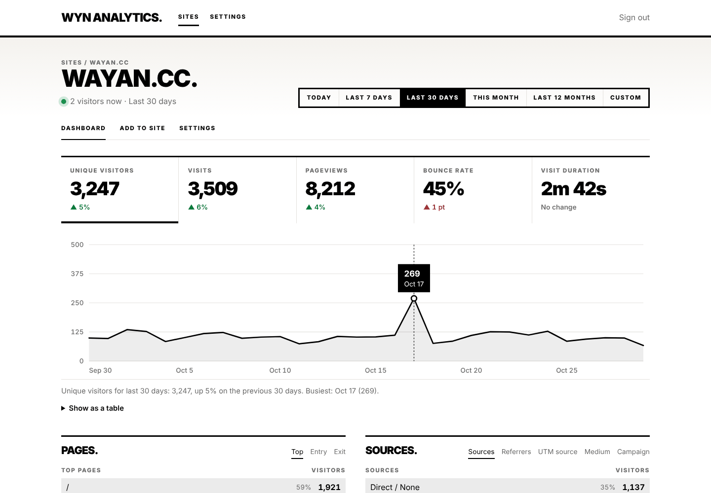
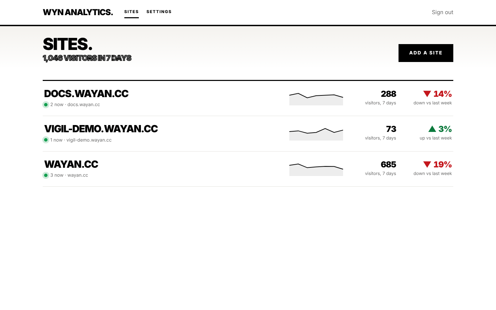
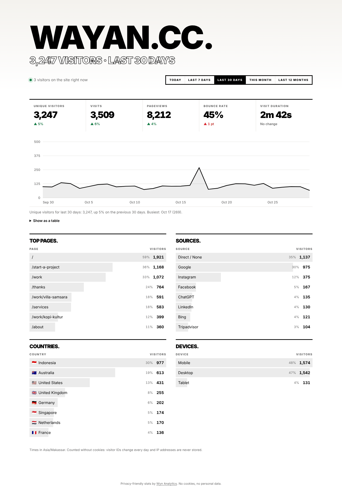
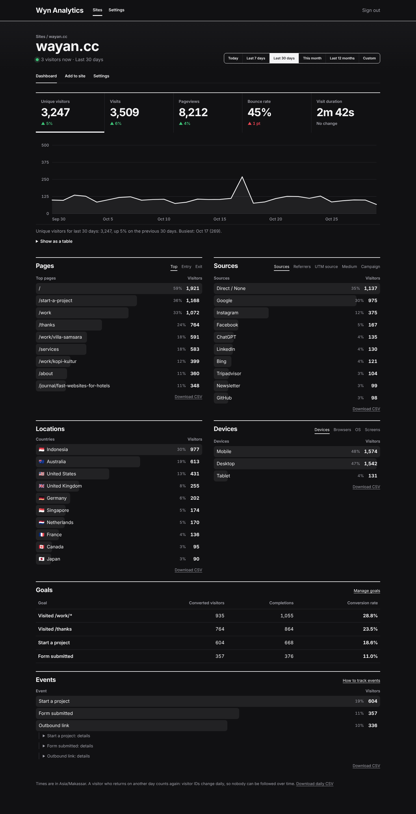

# Wyn Analytics

**Know your visitors. Not who they are.**

Cookieless website analytics that runs on cheap PHP hosting. Paste one 2 KB script into your site and see visitors, pages, sources, countries, devices, events and goals in a fast dashboard. No cookies, no IP addresses stored, and no cookie banner needed for the default setup.

PHP 8.2 and SQLite. No Composer packages, no database server, no build step. Upload it to any PHP host, or run it with Docker.



## Why

Plausible needs Elixir and ClickHouse. Umami needs Node and a database server. Matomo runs on PHP but is heavy and sets cookies by default. Wyn Analytics is one small app you can upload to the same shared hosting as your website, and it keeps your visitors' data in a single file you own.

## Features

- **Tiny tracking script.** About 1.8 KB gzipped, loads with `defer`, sets no cookies and no IDs. It counts single-page apps (history changes), engagement time, and optionally outbound links and file downloads.
- **The numbers you need:** unique visitors, visits, pageviews, bounce rate, visit duration, and visitors right now. Every number is compared with the previous period, with an arrow, a percentage, and color.
- **Breakdowns:** top, entry and exit pages; sources (Google, Instagram, ChatGPT…), referrers and UTM tags; countries; devices, browsers, operating systems and screen sizes.
- **Filters:** click any row to see only those visits, for example everyone who came from Instagram, or everyone who saw `/pricing`.
- **Events and goals:** `data-wyn-event="Signup"` on any link or button, or `Wyn.event()` from JavaScript. Goals turn pages and events into conversion rates.
- **Several sites,** each in its own time zone, so "today" is the owner's day.
- **Public stats page** per site, with an optional password, in big type.
- **JSON API** with read-only tokens, and CSV export of every table.
- **Two themes,** light and dark, WCAG AA contrast, and every chart has a text summary and a table view.



## How it stays private

| What | How |
| --- | --- |
| **Visitor IDs** | A visitor ID is a keyed hash of the site, IP address and browser string, using a random salt that's different every day. Salts are deleted once their date has ended everywhere on Earth. Nobody, including you, can recompute an old ID or link one day's visitors to the next, or one site's to another. |
| **IP addresses** | Never written to disk by Wyn Analytics: not in the database, not in its logs. Countries come from Cloudflare's header or a local lookup, and only the two-letter code is kept. The tests scan the database file for IPs and browser strings. Your web server's own access log is separate: the Docker image turns it off, and `deploy/` shows how for nginx. On shared hosting, turn off or shorten access logs for the stats subdomain in your control panel. |
| **Browser storage** | No cookies, no localStorage IDs. The only thing the script may store is an opt-out flag, when *you* visit your own site with `#wyn-ignore`. |
| **Global Privacy Control** | Visitors whose browser sends GPC aren't counted, by default. You can turn this off per site; GPC is a visitor's stated choice, so the default respects it. |
| **Retention** | Detailed visits are kept for 30 days (7–365, your choice) and power filters. Daily totals and top lists are kept forever, which keeps SQLite small and the dashboard fast. |

The trade-off: a visitor who comes back on another day counts as a new visitor. That's what makes it impossible to follow anyone over time.

Whether you need a consent banner depends on your country and setup, so check with your own advisor. With the default settings, Wyn Analytics stores no personal data and reads nothing from the visitor's device, which is the usual basis for running without one.

## Quick start

### Docker

```bash
git clone https://github.com/wayancc/wyn-analytics && cd wyn-analytics
docker compose up -d
```

Open `http://localhost:8080/admin`, create your account, and add a site. The compose file also starts a small worker that rolls up finished days.

### Shared hosting (cPanel, Plesk)

1. Upload the folder and point a subdomain (for example `stats.example.com`) at `public/`. If your host won't let you change the document root, upload it as-is: the included `.htaccess` serves `public/` and blocks everything else.
2. Make sure `storage/` is writable by PHP.
3. Open `/admin`, create your account, and add a site.
4. Optional: add an hourly cron job, `php /path/to/bin/wyn-analytics run`. If your host has no cron, use the web-cron URL from **Settings**, or skip it: the dashboard catches up on its own when you open it.

### Try it locally

```bash
php bin/wyn-analytics serve      # http://127.0.0.1:8000/admin
php tests/seed.php --database=storage/demo.sqlite --days=60   # optional demo data
```

## Add it to your site

```html
<script defer data-wyn-site="example.com" src="https://stats.example.com/wyn.js"></script>
```

Paste it before `</head>` on every page. The script lives at `/wyn.js` and sends to `/wyn/e`, because filter lists often block URLs containing "analytics". Some blockers may still block it; that's their users' choice.

| Attribute on the script tag | What it does |
| --- | --- |
| `data-wyn-outbound` | Counts clicks on links to other sites, as the event **Outbound link** |
| `data-wyn-downloads` | Counts clicks on PDF, ZIP, DOCX and other files, as **File download** |
| `data-wyn-local` | Also counts visits on `localhost`, for testing |
| `data-wyn-api="…"` | Send events to another URL |

**Events:**

```html
<a href="/book" data-wyn-event="Booking" data-wyn-prop-room="Garden suite">Book now</a>
```

```js
Wyn.event('Signup', { plan: 'Pro' });   // up to 5 properties
```

To call `Wyn.event` before the script has loaded, add this stub first: `<script>window.Wyn=window.Wyn||{};Wyn.q=Wyn.q||[];Wyn.event=Wyn.event||function(){Wyn.q.push(arguments)}</script>`

**Leave out your own visits:** open `https://example.com/#wyn-ignore` once in each browser (`#wyn-track` undoes it), or exclude your IP address under the site's settings. Only a keyed hash of an excluded IP is stored.

### Works with the other WYN projects

- **[Wyn Forms](https://github.com/wayancc/wyn-forms):** forms sent with `data-wyn-ajax` are counted as the event **Form submitted** automatically. For classic forms, add a pageview goal for your thank-you page.
- **[Inkdocs](https://github.com/wayancc/inkdocs):** paste the script tag into `theme/layout.php` before `</head>`. Search the **Top pages** panel to see which docs people read most.
- **[Vigil](https://github.com/wayancc/vigil):** Vigil's checks never show up as visits, because monitors are filtered out with other bots.

## Stats API

Create a read token under **Site → Settings → Stats API**. Only its hash is stored, so it's shown once.

```bash
curl -H "Authorization: Bearer wyn_…" "https://stats.example.com/api/stats.json?range=30d"
```

- `range`: `today`, `7d`, `30d`, `month`, `12mo`, or `custom` with `from` and `to` (`YYYY-MM-DD`).
- Filters: `f_source=Google`, `f_page=/pricing`, `f_country=ID`, and the same for `entry`, `exit`, `referrer`, `utm_source`, `utm_medium`, `utm_campaign`, `device`, `browser`, `os`, `screen`, `event` and `goal`.
- `limit`: rows per breakdown (1–100).

The response has `totals`, `previous`, `change`, `now`, `series`, `breakdowns` and `goals`.

## Command line

```
php bin/wyn-analytics run                         Roll up finished days and apply retention (cron: hourly)
php bin/wyn-analytics work [--every=600]          Keep running and do the same every 10 minutes (Docker, systemd)
php bin/wyn-analytics prune [--vacuum]            Delete detailed visits past retention now; --vacuum shrinks the file
php bin/wyn-analytics geo:update [--file=…]       Download the free DB-IP country database (or load a downloaded file)
php bin/wyn-analytics site:add --domain=… [--name=…] [--timezone=…]
php bin/wyn-analytics sites                       List sites with visitors in the last 7 days
php bin/wyn-analytics export --site=… [--from=…] [--to=…]   Daily stats as CSV
php bin/wyn-analytics user:password --email=…     Reset a password
php bin/wyn-analytics serve [--port=8000]         Local dev server
```

### Countries

Behind Cloudflare, set `'trust_proxy' => true` in `config.php` and countries come from Cloudflare's `CF-IPCountry` header. Otherwise run `geo:update` once and then monthly. It builds a compact lookup file (a few MB) from [DB-IP's free country database](https://db-ip.com/db/download/ip-to-country-lite) (CC BY 4.0, credited in the dashboard). If your host can't download files, download the CSV yourself and pass it with `--file`. City-level location is deliberately not supported.

## Configuration

Copy `config.example.php` to `config.php` to change server settings: the database path, the address of the install, a subfolder, the default time zone, `trust_proxy`, and the script and event paths. Everything else is in the dashboard.

## Performance

Measured with `php tests/bench.php` (100,000 events, 3 sites, 14 days) on a 2-vCPU cloud VM, PHP 8.3, SQLite 3.45:

| | |
| --- | --- |
| Ingest, single PHP process | about 5,400 events/second |
| Ingest over HTTP, PHP built-in server, 16 at a time | about 1,300 events/second |
| Database size, detailed data | about 15.5 MB per 100,000 events |
| Rolling up 42 site-days | 0.7 s |
| Dashboard, 30 days, all panels | 40 ms (filtered: about 110 ms) |
| A year of rollups plus 30 days of detail, a site with ~110 visits a day | 4.5 MB |

These are real numbers from that machine, not a promise. Shared hosting is usually slower; run `php tests/bench.php` on your own host to see what it handles.

## Design

Two looks, switched under **Settings → Look**, for the dashboard and public pages:

- **Bold** (default), based on [wayan.cc](https://wayan.cc): black on white, heavy uppercase Inter headlines, square corners and thick rules. Big type is kept for the public stats page and empty states; working screens use compact headings.
- **Neutral:** quieter type and rounded corners, to sit beside your own brand.

Both follow the system light or dark mode. Status colors only show state: green and red for better and worse (fewer bounces is better), and green for "visitors now". Changes are always written out too, so color is never the only signal.

Charts are hand-drawn SVG, rendered on the server so they work without JavaScript and in print. A little vanilla JavaScript adds the hover tooltip, and the chart works with the arrow keys. Every chart has a written summary and a table view.

Inter is bundled (SIL Open Font License). The dashboard, the public page and the tracking script make no requests to Google, a CDN or anyone else.

| Bold | Neutral |
| --- | --- |
|  |  |

All 24 screenshots (both themes, light and dark, desktop and mobile) are in [`.github/screenshots`](.github/screenshots).

All CSS classes, data attributes, JS names and database tables use the `wyn-` prefix (`wyn_` in SQL), so nothing clashes with your site.

## Security

- Sign-in and public-page passwords are rate-limited (5 tries per 15 minutes); the throttle stores a keyed hash, never the IP.
- CSRF tokens on every form, `SameSite` session cookies, `X-Frame-Options`, and escaping everywhere, including tracked paths and event names.
- CSV exports neutralise spreadsheet formulas.
- API tokens and public-page passwords are stored as hashes.
- The tracking endpoint answers every request the same way (`202`), so it can't be used to discover which sites exist. The `X-Wyn-Result` response header says why an event was skipped, which helps during setup.
- A single visit stops counting after 2,000 events, so one script can't flood a site's numbers.
- `storage/` is blocked from the web (`.htaccess` included; see `deploy/nginx.conf` for nginx).

## Development

```bash
php tests/run.php     # 130 checks, no dependencies, no internet
php tests/bench.php   # load benchmark
```

The suite covers tracking, bot filtering, privacy (no IPs on disk, salt rotation, no cookies), time zones (UTC+8, UTC-7, and daylight-saving days with 23 and 25 hours), rollups matching raw data exactly, retention, goals, filters, the API, the public page, security, zero external requests, and WCAG contrast for every theme and mode.

## Roadmap

- [ ] Weekly email reports
- [ ] Funnels
- [ ] Multiple users with roles
- [ ] Import from Plausible, Umami and Google Analytics CSV
- [ ] Vigil uptime overlay on the chart
- [ ] WordPress plugin for the script tag
- [ ] An `analytics` option in Inkdocs' config.php

## License

[AGPL-3.0](LICENSE) for the app. You can self-host it freely, including commercially; if you offer a modified version as a service, you must share your changes.

`public/assets/wyn-analytics.js`, the script you embed on your websites, is [MIT licensed](LICENSE-MIT), so embedding it never affects your own site's code.

Inter is under the SIL Open Font License (`public/assets/fonts/OFL.txt`). Country data, when you download it, is © DB-IP.com under CC BY 4.0.

Contributions need a signed CLA; see [CONTRIBUTING.md](CONTRIBUTING.md).
